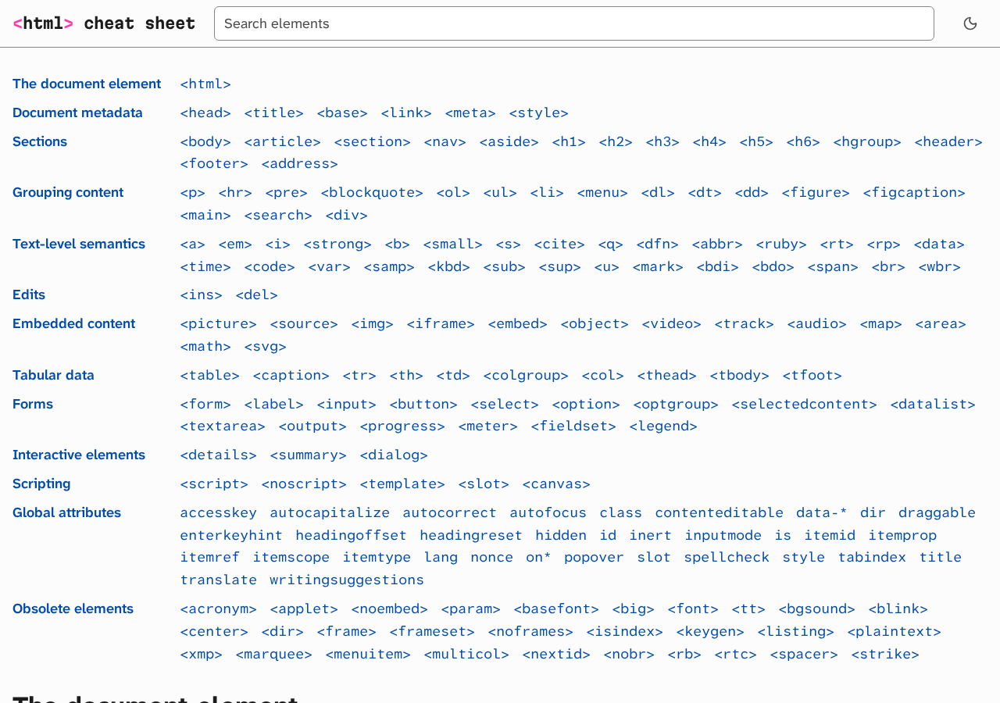

# HTML cheat sheet

One page that lists every HTML element and global attribute with a short description, the example code and the rendered result side by side. It is live at [html.fmartin.ch](https://html.fmartin.ch).

## What it does

The page has one entry per element or global attribute in the [WHATWG HTML standard](https://html.spec.whatwg.org/multipage/), grouped by the standard's chapters, plus a chapter of obsolete elements that names what to use instead. Each entry shows:

- what the element is for, its default CSS `display` and its accessibility role;
- the attributes you will reach for most;
- whether every major browser supports it, as a [Baseline](https://web.dev/baseline) badge;
- a usage note where one matters, such as when to pick `<strong>` over `<b>`;
- example code next to what your browser renders for it. **Edit** turns the code into an editor, and the output follows as you type;
- links to MDN and to the section of the standard.

A search box filters the entries and tolerates typos. The page follows your light or dark system setting, or the choice you make in the header, and works offline after the first visit.



## Requirements

A browser to use the page.

Node.js 24 and [pnpm](https://pnpm.io) to build it; `package.json` names the pnpm version. The end-to-end tests also need Docker or Podman.

## Install

```sh
git clone https://github.com/martinfrancois/html-cheat-sheet.git
cd html-cheat-sheet
pnpm install
```

## Usage

```sh
pnpm run dev       # development server with reload on save
pnpm run build     # static site in dist/
pnpm run preview   # serve dist/
```

Each entry is a YAML file under `src/content/entries/`, with the example written once; the page shows it both as code and as live output. `docs/agents/content-entries.md` says where each fact in an entry comes from. `pnpm run sync-spec` refreshes `src/data/spec.json`, the list of elements, chapters, default display values and roles taken from the standard and from HTML-AAM.

## Test

```sh
pnpm run check     # TypeScript and Astro type check
pnpm test          # unit tests: entry data, styles, decision records
pnpm run test:e2e  # Playwright in the official container: behaviour, accessibility, screenshots
```

`docs/agents/testing.md` explains what each layer catches and how to update screenshots.

## Limitations

- The coverage test stays a to-do until every element and global attribute has its entry.
- A few examples link to other sites. Following those links needs a network connection; nothing else on the page does once it has been opened.

## Third-party code

Libraries and fonts come from npm and keep their own licenses: Astro, Tailwind CSS, CodeMirror, Shiki, uFuzzy, Workbox, PostHog, marked, and the Atkinson Hyperlegible and Martian Mono fonts (SIL Open Font License). `docs/adr/0009-use-established-libraries-for-each-concern.md` lists which library covers which concern.

## License

MIT, see [LICENSE](LICENSE). The third-party packages keep their own licenses as listed above.
